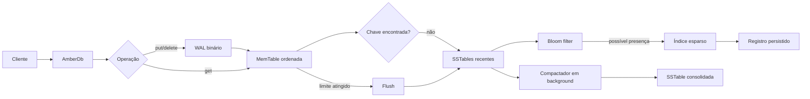

# AmberLSM

Engine de armazenamento chave-valor embarcada, escrita em Rust e baseada em
LSM-Tree (Log-Structured Merge-Tree). O projeto foi criado como estudo prático
de motores de armazenamento, persistência, recuperação após falhas e
concorrência.

O código é distribuído sob a [GNU General Public License v3 ou posterior](LICENSE).

> Status: protótipo funcional em evolução, com WAL, MemTable, SSTables,
> Bloom filter, índice esparso e compactação em background.

## Objetivos

- oferecer `put`, `get` e `delete` para chaves e valores binários;
- confirmar escritas no WAL antes de atualizar a MemTable;
- sobreviver a reinicializações e registros WAL incompletos;
- transformar MemTables em SSTables imutáveis;
- acelerar leituras com Bloom filter e índice esparso;
- compactar tabelas antigas sem interromper o caminho normal de leitura;
- manter o núcleo pequeno, legível e fácil de testar em Linux e z/OS.

## Como executar

```bash
cargo test
cargo clippy --all-targets --all-features -- -D warnings
```

### CLI

```bash
cargo run --bin amberlsm -- ./dados put linguagem Rust
cargo run --bin amberlsm -- ./dados get linguagem
cargo run --bin amberlsm -- ./dados scan
cargo run --bin amberlsm -- ./dados metrics
cargo run --bin amberlsm -- ./dados metrics-json
cargo run --bin amberlsm -- ./dados compact
```

Para uma medição simples e reproduzível:

```bash
cargo run --release --bin amberlsm-bench -- 100000
```

Para testar a integração por stdin/stdout:

```bash
printf 'PUT 6a617661 6d61696e6672616d65\nGET 6a617661\nSCAN\n' \
  | cargo run --bin amberlsm-protocol -- ./dados
```

Os exemplos mainframe ficam em `mainframe/`: COBOL, JCL, REXX, Java e HLASM.

O fluxo já foi validado no ambiente z/OS: o job COBOL/JCL terminou com `CC 0000`
e o job HLASM/JCL também terminou com `CC 0000`.

O uso básico é síncrono:

```rust
use amberlsm::{AmberDb, Options};

let db = AmberDb::open("./dados", Options::default())?;
db.put(b"linguagem", b"Rust")?;
assert_eq!(db.get(b"linguagem")?, Some(b"Rust".to_vec()));
db.delete(b"linguagem")?;
db.close()?;
# Ok::<(), amberlsm::Error>(())
```

## Arquitetura resumida



## Persistência

Cada escrita segue esta ordem:

1. serialização da operação;
2. append no WAL;
3. `sync_data` quando `Options::sync_writes` está habilitado;
4. atualização da MemTable;
5. flush quando o limite configurado é alcançado.

No reinício, o WAL é reproduzido até o primeiro registro incompleto ou com
checksum inválido. O registro parcial final não é tratado como uma operação
confirmada.

## SSTables

As SSTables são imutáveis e armazenam:

- registros ordenados;
- índice esparso com offsets de chaves de referência;
- Bloom filter para evitar leituras desnecessárias;
- tombstones para representar exclusões;
- formato versionado por número mágico.

Detalhes do formato estão em [docs/formato-sstable.md](docs/formato-sstable.md).
O arquivo `MANIFEST` registra a lista publicada de SSTables e é atualizado com
rename atômico após cada flush ou compactação.

## Compactação

Quando o número de SSTables atinge `Options::compaction_threshold`, um worker
em background recebe uma solicitação de compactação. As versões mais recentes
prevalecem, tombstones são removidos somente quando já não existe uma tabela
mais antiga que precise deles, e o resultado é publicado por rename atômico.

O fluxo completo está descrito em [docs/arquitetura.md](docs/arquitetura.md).

## Testes no z/OS

O roteiro de validação para o ambiente z/OS está em
[docs/testes-zos.md](docs/testes-zos.md). Ele separa testes unitários,
persistência, reinício, corrupção controlada e testes de carga para que cada
resultado seja reproduzível.

O z/OS é usado como ambiente de integração USS, não como ambiente de
compilação Rust. Essa decisão evita instalar um toolchain não disponível no
servidor e mantém o ambiente compartilhado inalterado.

Como o foco profissional também é mainframe, a estratégia de integração está
descrita em [docs/mainframe.md](docs/mainframe.md). COBOL, JCL/REXX, Java e
HLASM entram em camadas específicas, sem artificialmente substituir o núcleo
Rust.

## Estado atual e próximos passos

O núcleo já é adequado para demonstração técnica e experimentação. Antes de
chamá-lo de banco de dados de produção, ainda devem ser adicionados limites de
memória, testes de falha de processo, benchmark de leitura e uma política
explícita para erros do worker de compactação.

## Segurança

Credenciais locais nunca devem ser commitadas. O arquivo `.env` está listado no
`.gitignore`; use um `.env.example` sem valores reais se precisar documentar a
configuração.
