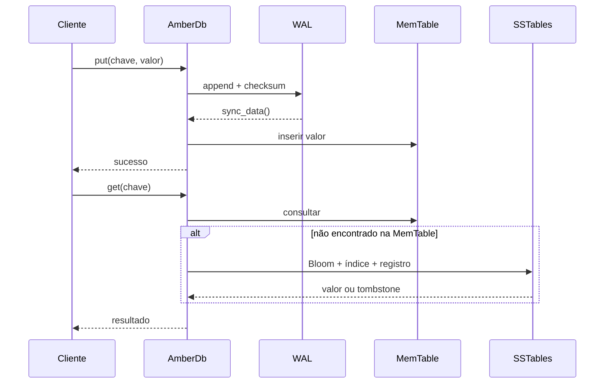
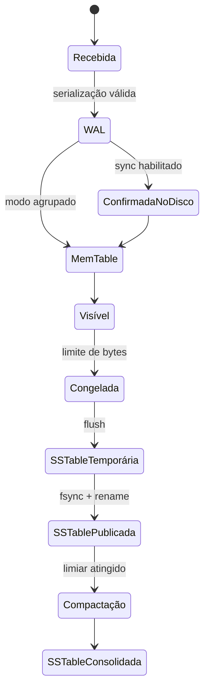
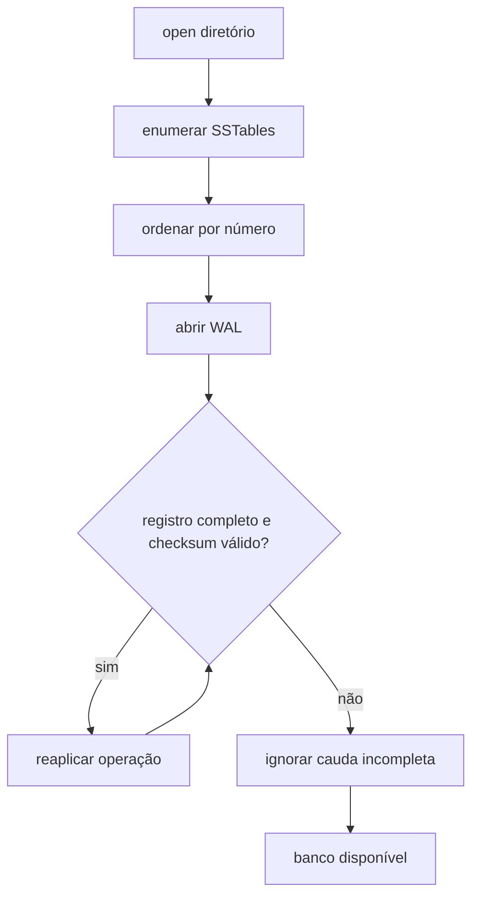

# Arquitetura do AmberLSM

## Visão geral

O AmberLSM separa o caminho rápido de escrita do trabalho mais pesado de I/O.
A MemTable atende as operações recentes em memória; o WAL garante que uma
operação confirmada possa ser reconstruída; SSTables representam o estado
imutável no disco.

## Estados de uma escrita

## Consistência de leitura

A ordem de consulta é sempre da informação mais nova para a mais antiga:

1. MemTable ativa;
2. SSTable mais recente;
3. SSTables anteriores;
4. ausência da chave.

Um tombstone encontrado em uma camada mais nova encerra a busca e impede que
uma versão antiga seja devolvida.

## Concorrência

O estado compartilhado é protegido por `Mutex`. O worker de compactação recebe
comandos por um canal e aguarda o mesmo lock apenas durante a publicação da
compactação. Isso mantém a implementação simples para o protótipo e cria um
ponto claro para futura substituição por snapshots ou estruturas lock-free.

O `MANIFEST` registra os nomes das SSTables válidas. Ele é escrito em um arquivo
temporário, sincronizado e publicado por rename atômico, reduzindo o risco de
um reinício observar uma lista parcialmente atualizada.

## Recuperação

O WAL usa número mágico, tipo, tamanhos de chave e valor, payload e checksum.
Uma falha no final do arquivo não transforma bytes parciais em uma operação
visível.
