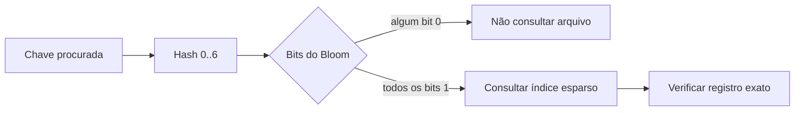

# Formato das SSTables

Todos os inteiros são little-endian. A versão atual usa o número mágico `ALS2`.

## Organização

```text
┌──────────┬───────────────┬──────────────┬────────────────┐
│ magic    │ cabeçalho     │ sparse index │ Bloom + dados  │
│ ALS2     │ contadores    │ chaves/offset│ registros      │
└──────────┴───────────────┴──────────────┴────────────────┘
```

O cabeçalho contém:

```text
magic:              [u8; 4] = "ALS2"
index_count:        u32
bloom_size_bytes:   u32
bloom_hashes:       u8
```

Cada entrada do índice esparso contém:

```text
key_len:            u32
key:                [u8; key_len]
data_offset:        u64
```

O índice registra uma chave a cada 16 registros. Para uma leitura, a chave de
referência imediatamente anterior define o ponto inicial da busca sequencial.

## Bloom filter

O filtro possui aproximadamente dez bits por entrada, no mínimo 64 bits, e
sete posições calculadas por chave. Um resultado negativo garante que a chave
não está naquela SSTable; um resultado positivo apenas indica que a leitura
deve continuar no índice.



## Registro de dados

```text
kind:               u8   // 1 = valor, 2 = tombstone
key_len:            u32
value_len:          u32
key:                [u8; key_len]
value:              [u8; value_len]
```

O valor de um tombstone tem tamanho zero. A compactação pode remover um
tombstone quando todas as versões antigas relevantes já foram incorporadas na
SSTable consolidada.
