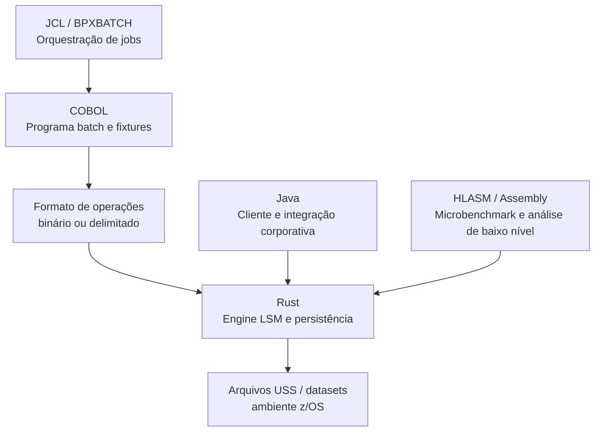

# AmberLSM para mainframe

O AmberLSM deve demonstrar conhecimento de sistemas modernos e tradicionais.
Cada linguagem entra em uma camada em que ela faz sentido:



## Rust

Rust permanece como núcleo do AmberLSM porque oferece controle de memória,
segurança de concorrência e I/O explícito. A implementação local deve ser a
referência funcional, com testes, benchmarks e formato de dados versionado.

## COBOL

COBOL será usado para um gerador/consumidor de operações batch. O programa
poderá:

- gerar cargas de `PUT` e `DELETE` a partir de registros de negócio;
- consumir o resultado de um `SCAN` para validação;
- testar chaves EBCDIC, campos de tamanho fixo e valores numéricos;
- simular um fluxo de processamento de arquivos típico de mainframe.

Isso demonstra a ponte entre dados legados e uma engine moderna sem tentar
transformar COBOL em uma biblioteca de armazenamento concorrente.

## JCL e REXX

JCL/REXX serão usados para orquestração:

- preparar datasets e diretórios USS;
- executar cenários de carga;
- capturar logs e códigos de retorno;
- separar etapas de ingestão, consulta, compactação e validação;
- gerar um relatório de execução.

O z/OS não será alterado com um toolchain Rust sem necessidade. Os jobs podem
validar o ambiente, arquivos e integração com ferramentas disponíveis.

## Java

Java será um cliente de integração, preferencialmente contra uma pequena API
TCP/HTTP do AmberLSM. Essa camada representa aplicações corporativas que
consomem serviços de armazenamento sem conhecer o formato interno das
SSTables.

Java não deve duplicar a engine. Seu papel é demonstrar consumo por uma
aplicação empresarial, tratamento de erros e métricas.

## HLASM / Assembly

HLASM deve entrar como experimento controlado, não como substituição da engine.
Os usos adequados são:

- microbenchmark de cópia e comparação de buffers;
- medição de custo de conversão EBCDIC/ASCII quando disponível;
- estudo de layout e alinhamento de registros;
- documentação de uma rotina crítica e sua chamada por uma camada superior.

Qualquer rotina assembler deve ter uma implementação de referência em Rust e
testes equivalentes. Assim o projeto continua portável e a comparação fica
tecnicamente honesta.

## Ordem de implementação

1. Adicionar um protocolo de operações por stdin/stdout ao binário Rust.
2. Criar fixtures COBOL para gerar entradas e validar saídas.
3. Criar JCL/REXX para orquestrar os cenários no USS/z/OS.
4. Criar um servidor mínimo e um cliente Java.
5. Adicionar o experimento HLASM somente depois de medir o gargalo real.

O resultado será um projeto de portfólio com Rust moderno, integração
mainframe, COBOL, JCL, Java e uma trilha opcional de Assembly, cada tecnologia
com uma responsabilidade clara.

## Protocolo de integração

O binário `amberlsm-protocol` recebe comandos por stdin e responde por stdout.
Chaves e valores são hexadecimais para transportar bytes arbitrários:

```text
PUT 6a617661 6d61696e6672616d65
GET 6a617661
SCAN
```

Respostas:

```text
OK
VALUE 6d61696e6672616d65
ITEM 6a617661 6d61696e6672616d65
END
```

Esse contrato é usado pelo fixture COBOL e pelo cliente Java. O adaptador não
expõe o layout interno do WAL ou das SSTables.
