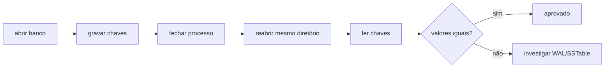

# Roteiro de testes no z/OS

Este roteiro deve ser executado no ambiente z/OS já configurado para o projeto.
A ideia é registrar comandos, versão do compilador, sistema de arquivos usado,
quantidade de operações e resultado observado.

## Resultado da primeira validação

- SSH/USS: aprovado.
- Diretório de trabalho: `/z/<userid>`.
- Shell: `zsh`.
- `rustc` e `cargo` no servidor: não disponíveis.
- Instalação de toolchain: não realizada, para preservar o ambiente.
- COBOL/JCL: `JOB05146`, `CC 0000`.
- HLASM/JCL: `JOB05260`, `CC 0000`.
- Sistema identificado no spool: z/OS V3R1.

O z/OS permanece como ambiente de integração e observação de filesystem. A
compilação e os testes unitários do Rust continuam no ambiente local.

O job COBOL gerou três operações `PUT` em arquivo USS. Após conversão de
EBCDIC para ISO-8859-1, o conteúdo validado foi:

```text
PUT 435553544f4d45522d30303031 636f626f6c2d6d61696e6672616d65
PUT 435553544f4d45522d30303032 636f626f6c2d6d61696e6672616d65
PUT 435553544f4d45522d30303033 636f626f6c2d6d61696e6672616d65
```

O job HLASM foi montado, ligado e executado com retorno zero. A primeira
tentativa revelou erros de colunas fixas e registradores simbólicos; o fonte
foi corrigido e o segundo job passou.

## 1. Identificação do ambiente

```text
rustc --version
cargo --version
uname -a
pwd
```

Guardar essa saída junto do relatório do teste. Se o ambiente utilizar shell,
toolchain ou caminho de arquivos diferente, registrar a adaptação.

## 2. Validação automática

```bash
cargo fmt --check
cargo test --all-targets
cargo clippy --all-targets --all-features -- -D warnings
```

Critério de aprovação: todos os testes passam, nenhum warning é promovido a
erro e os artefatos são gerados no diretório de build esperado.

## 3. Persistência e reinício



O diretório de dados deve ser preservado entre os processos. O teste precisa
verificar `put`, atualização, `delete`, tombstone e valor binário contendo
bytes zero.

## 4. Flush e compactação

Usar um `memtable_bytes` pequeno para gerar várias SSTables. Depois verificar:

- todas as versões mais recentes continuam legíveis;
- chaves excluídas permanecem ausentes;
- o número de SSTables diminui após compactação;
- o processo continua aceitando leituras durante o trabalho em background;
- a reabertura após a compactação mantém os mesmos resultados.

## 5. Corrupção controlada

Criar uma cópia do `wal.log`, truncar apenas a cauda e reabrir o banco. O
registro incompleto final deve ser ignorado sem corromper os registros válidos
anteriores. Depois repetir com uma SSTable e confirmar que o erro é explícito.

Não modificar o único diretório de dados usado por outros testes; cada cenário
deve usar um diretório temporário próprio.

## 6. Relatório para portfólio

Registrar:

- objetivo do cenário;
- comando executado;
- configuração usada;
- resultado esperado;
- resultado observado;
- limitações encontradas;
- próxima melhoria planejada.

Esse registro transforma o teste em evidência técnica reproduzível e ajuda a
explicar decisões do projeto em entrevistas.
